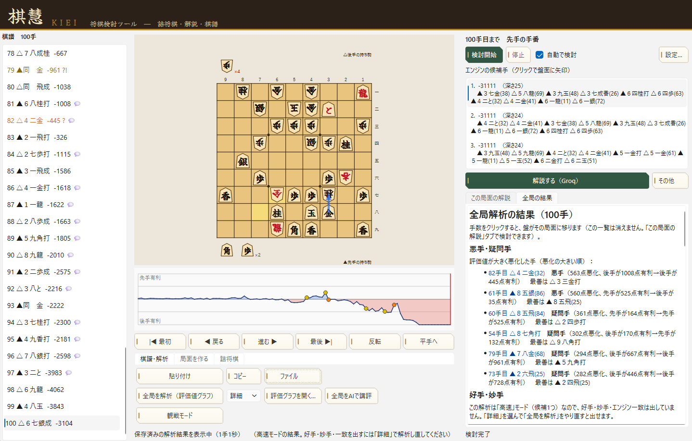
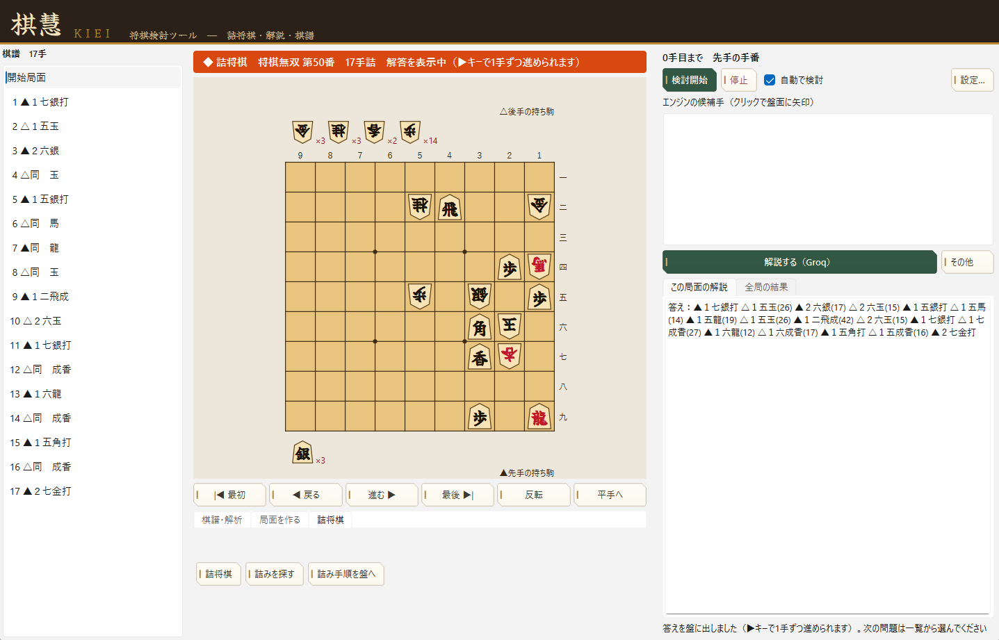

# 棋慧（KIEI）

将棋の棋譜を **検討** し、**AIに解説** （実験的）してもらい、詰将棋モードを搭載したWindows アプリ。

要するにShogi-GUIやShogiHomeの類似品。継ぎ盤機能などはない。

作者は詰将棋が好きなのでそちらの機能を充実させました。厳密な余詰検出などは柿木将棋Ⅸで行ってください。

詰将棋の作品評価などはAIにはできません。

（多分今後も当分できないことでしょう。詰将棋の美観評価は数値化できないと言われてます。）

- 盤で駒を動かすと、将棋エンジンが候補手と評価値を出します。指した手ごとに**評価値グラフがリアルタイムで伸びていきます**（詰将棋モードでは出ません）。
- 検討中に別の手を指して分岐しても、「元の手順へ戻る」ボタンで元の棋譜に戻れます。
- **観戦モード**：タイトル戦の中継などで棋譜（KIF）をコピーすると、新しい手が増えるたびに自動で読み込んで形勢グラフを伸ばします。
- 気になる局面を、AI（Gemini / ChatGPT / Claude / Groq（GPT-OSS-120B））が文章で解説します。おまけ程度。
- 棋譜全体を解析して、評価値グラフで形勢の流れを見られます。悪手・疑問手や好手・妙手の一覧も出ます（「詳細」モードで解析したとき）。
- 戦型（矢倉・振り飛車など）を自動で判定して盤の上に表示します（精度低め）
- 詰将棋モード：「将棋図巧」「将棋無双」200問を収録。自分の作った問題の余詰検査もできます。※柿木将棋には敵いません。
- 実戦の盤面から詰将棋を抽出する簡易クリーナー
- 詰将棋データベース機能（簡易的なものです）
- 詰将棋の検証用に、自作の小さな探索エンジンを同梱しています。
  KomoringHeights は詰みを非常に高速に読み切る優れたエンジンですが、
  詰将棋の規則（無駄合を除いた最長手数）を前提に作られているわけではないため、
  無駄合を含む手順を答えとして返すことがあります。
  棋慧では、Komoringの手順を詰将棋の規則で検証し、無駄合を見つけた場合に指摘します。
  15手前後までの問題であれば、棋慧単独で正解手順と変化まで求められます。
  それ以上の手数では、検証（無駄合の指摘）が中心です。
- 将棋アプリ「棋桜」の画面を撮影（スクリーンショット）すると、その局面を読み取れます（棋桜専用。将棋ウォーズなどの将棋ソフトの画面には対応していませんし、する気もありません。ソフト指しに利用しないでください。）
- 「図→局面（画像）」ボタン：Webページ・棋書・論文などの**静止画の盤面図**から局面を読み取れます（画像をコピーしてからボタンを押すか、画像ファイルを選びます）。駒の字を様々なフォントで学習させてあるので、特定のサイトに限りません。ただし**精度は100%ではない**ので、読み取り後に盤と持ち駒を必ず確認してください。持ち駒は、盤の左右に縦書きで書かれた形式に対応しています（「金三」のような漢数字の持ち駒や、本をスマホで撮った写真もある程度読めます）。
- 「局面→図」ボタン：今の局面を盤面図の画像にして、コピー・保存できます。ブログや棋書風の資料づくりにどうぞ。
- 画面は「棋譜・解析」「局面を作る」「詰将棋」のタブに分けてあります。

## 画面

棋譜を全局解析したところ。評価値グラフと、悪手・疑問手の一覧が出ます。

詰将棋モード（将棋無双 第50番）。答えを盤に出して、1手ずつ確認できます。

---

## 1. 必要なもの

|                                   | 用途                   | 必須？                 |
| --------------------------------- | ---------------------- | ---------------------- |
| Windows 10 / 11（64ビット）       | OSはWindowsのみ対応    | ◎                     |
| Python 3.10 以上                  | Pythonで動きます。     | ◎                     |
| 将棋エンジン（水匠5など）         | 候補手・評価値         | 検討機能に必須         |
| 詰将棋エンジン（KomoringHeights） | 詰将棋の余詰検査・解答 | 詰将棋モードで使う場合 |
| AIのAPIキー                       | 解説文を作る           | 解説機能に必須         |

エンジンもAPIキーも無くても、盤を動かす・棋譜を読み込む・収録問題を眺めることはできますがそれだと使う意味ないです。

## 2. インストール

1. このリポジトリの「Code」→「Download ZIP」で取得。好きな場所に展開してください。
2. [Python](https://www.python.org/downloads/) をインストール。**インストール画面の一番下の「Add python.exe to PATH」に必ずチェック**を入れてください。
3. 展開したフォルダの `setup.bat` をダブルクリックします。（初回だけ・数分かかります）。
4. `kiei.vbs`（または `start.bat`）をダブルクリックすると起動します。
   - 起動しないときは、同じフォルダにできる `error.log` の内容を確認してください。

## 3. 将棋エンジンを入れる

棋慧には将棋エンジンは**含まれてません**。別に入手してください。入手方法は以下リンクから。

### 3-1. 検討用エンジン：水匠5（CPUだけで動きます）

棋力はおなじみです。GPUが無いPCでも動きます。

1. [やねうら王の配布ページ（GitHub）](https://github.com/yaneurao/YaneuraOu/releases) の関連ページから、水匠5入りのやねうら王（Windows版zip）を入手します。
   - 入手先やファイル名は変わることがあります。「水匠5 やねうら王 ダウンロード」で検索して、**配布元が公式（作者の GitHub）であること**を確認してください。
2. zip を好きな場所に展開します（例：`C:\engines\suisho5`）。
3. 展開すると `.exe` が複数入っています。名前の末尾が CPU の種類を表します。
   - `avx2`：最近の Intel / 多くの AMD の CPU 向け（まずこれを試す）
   - `zen2`：AMD Ryzen 向け
   - `sse42`：古い CPU 向け
   - 起動に失敗するときは、別の名前のものに変えてみてください。
4. 棋慧の右上「設定…」を開き、**「エンジン（exe）」** の欄で、選んだ `.exe` を指定します。
5. 評価関数（`nn.bin`）が最初から入っている exe なら、これで終わりです。棋慧には評価関数フォルダを指定する欄はなく、エンジン任せです。
   - 作者の環境（水匠5・avx2版）では、`eval` フォルダに `nn.bin` を置かない状態で動いています。置いたら起動に失敗した場合は、`nn.bin` を別の場所へ移してみてください。

### 3-2. GPUがある人向け：dlshogi

NVIDIA のグラフィックボードがある人は、ディープラーニング系のエンジン **dlshogi** を使うと、より速く深く読めます。設定の仕方は水匠5と同じ（「エンジン（exe）」に指定）です。

> ※ 棋慧との動作確認がまだ済んでいません。

### 3-3. 詰将棋用エンジン：KomoringHeights

詰将棋モードで「余詰があるか」「正解手順は何か」を調べるときに使います。詰将棋モードを使わないなら不要です。

1. [KomoringHeights のリリースページ](https://github.com/komori-n/KomoringHeights/releases) から、Windows 用のファイルをダウンロードします。
2. 展開して、好きな場所に置きます（例：`C:\engines\komoring`）。
3. 棋慧の「設定…」→ **「詰将棋用エンジン（exe）」** で、その `.exe` を指定します。

### 3-4. 詰将棋の判定を速くする（任意・Windowsのみ）

棋慧の詰将棋モードには、短い手数の詰みを判定するスクリプト（`tsume.py`）が入っています。これをC++で作り直した高速版が `tsume.dll` です。**なくても動きます。** 入れると、手数が長い局面の判定が高速化されます。（たとえばある局面の7手詰の判定で、Python版 約210秒 → DLL版 約1.5秒でした）。

1. [Releases](https://github.com/hanachanX/KIEIProject/releases) から `tsume.dll` をダウンロードします。
2. 棋慧のフォルダの中の `native_tsume` フォルダに入れます（`native_tsume\tsume.dll` になります）。
3. 棋慧を起動し直します。DLLが読めないとき、または置いていないときは、自動で従来のPython版に切り替わります。

- 「64ビット版のPython」で動きます。
- 署名のないファイルなので、ウイルス対策ソフトが警告を出すことがあります。心配な人は、同じフォルダにあるソース（`tsume.cpp`）から自分でビルドしてください。（Visual Studio の「C++によるデスクトップ開発」が必要。`native_tsume\build.bat` を実行）。
- KomoringHeights（詰将棋エンジン）とは別のものです。長い詰将棋の解答や余詰の検査は、これまでどおりKomoringHeightsが担当します。

### 3-5. エンジンの設定値

「設定…」では、次の値も変えられます。分からなければそのままでOK。

- **スレッド数**：エンジンが使うCPUの数。PCのコア数より少なめにすると、他の作業が重くなりません
- **ハッシュ(MB)**：エンジンが使うメモリ量。PCのメモリの 1/4 程度までが目安です
- **全局解析：並列エンジン数**：棋譜全体を解析するとき、同時に動かすエンジンの数

## 4. AI解説の設定

使えるAIは次の4つです。**どれか1つ**のAPIキーがあれば解説が使えます。

| AI                   | 特徴                                                 |
| -------------------- | ---------------------------------------------------- |
| Gemini（Google）     | 無料枠あり。まず試すならこれ                         |
| Groq（GPT-OSS-120B） | 無料枠あり。応答速め。あまり使うと制限がかかります。 |
| ChatGPT（OpenAI）    | 有料（従量課金）わざわざお金を払うほどの価値はない。 |
| Claude（Anthropic）  | 有料（従量課金）同上                                 |

1. 使いたいAIの会社のサイトでアカウントを作り、「APIキー」を発行します。
2. 棋慧の「設定…」を開き、該当する **「○○ APIキー」** の欄に貼り付けます。
3. 画面右側の「解説する（○○）」ボタンで、解説する局面を選んで実行します。

**APIキーの扱いに注意してください**

- キーは **PCの `config.json` に保存されます**。管理はこのご時世ですから厳重に。
- 有料のAI（ClaudeやChatGPT)を使うときは、各社の管理画面で **月の利用上限を低めに設定** しておくと安心です。
- AIの解説は参考情報です。ただ読み筋を渡しているだけなのでそこは割り引いてみてください。※あくまで実験的試みです。最善手の判断はエンジンの評価値を優先してください。

## 5. 収録している詰将棋について

詰将棋モードには、次の200問が入っています。

- **将棋無双**（伊藤宗看・1734年）
- **将棋図巧**（伊藤看寿・1755年）

どちらも江戸時代の作品で、**著作権は切れています**。盤面と正解手順のみを収録しています。

※古典作品には、不詰・不完全作（余詰や早詰を含む）が混じっています。該当する問題には、詰将棋モードの「メモ」欄に注記を付けています。無双74番は江戸時代の原図の「15と」がない図を採用しています。東洋文庫版は「15と」が追加されていますがその順は作意とは思われずまた歩余りとなることから宗看の意図した順ではないと判断しました。

この2大作に対する正誤は以下が詳しいです。

[詰むや詰まざるや - 詰棋書正誤表置場](https://tsumeki.memo.wiki/d/%B5%CD%A4%E0%A4%E4%B5%CD%A4%DE%A4%B6%A4%EB%A4%E4)

## 6. よくある困りごと

| 症状                           | 対処                                                                                      |
| ------------------------------ | ----------------------------------------------------------------------------------------- |
| 起動しない                     | `error.log` を確認。Python が PATH に入っているか確認                                   |
| 候補手が出ない                 | 「設定…」でエンジンの `.exe` が指定されているか。別のCPU種別の `.exe` に変えてみる   |
| エンジンが強制終了する         | `eval` フォルダの `nn.bin` を別の場所へ移す。別のCPU種別の `.exe` を試す（3-1参照） |
| 解説が出ない                   | APIキーが入っているか。無料枠の上限に達していないか                                       |
| 詰将棋の判定が遅い             | 3-4 の `tsume.dll` を入れる（なくても動くが遅い）                                       |
| 詰将棋の余詰検査ができない     | 「詰将棋用エンジン」が指定されているか                                                    |
| タスクバーのアイコンが元に戻る | `kiei.vbs` から起動する（`.py` を直接開くと Python のアイコンになります）             |

## 7. ライセンス・謝辞

- 棋慧のプログラム本体：[MIT License](LICENSE)（自由に使用・改変・再配布できます。無保証）
- 駒と看板の筆文字：[Yuji Syuku](https://fonts.google.com/specimen/Yuji+Syuku)（SIL Open Font License 1.1。`fonts/OFL_YujiSyuku.txt` を参照）
- 使っている部品：[python-shogi](https://github.com/gunyarakun/python-shogi)、PyQt6、OpenCV、scikit-learn
- 将棋エンジンは同梱していません。水匠5・やねうら王・KomoringHeights・dlshogi は、それぞれの作者のライセンスに従ってご利用ください
- 将棋図巧・将棋無双：江戸時代の作品（パブリックドメイン）

## 8. 免責

本ツールの利用によって生じた損害について、作者は一切の責任を負いません。AIの利用料金（API 課金）は有料モデルの場合ご自身の負担となります。APIキーの保管にはくれぐれも注意してください。
